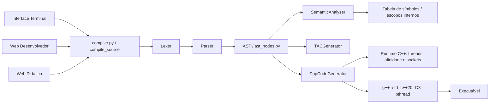
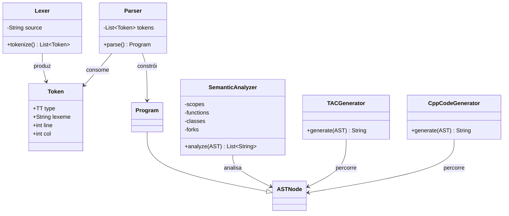
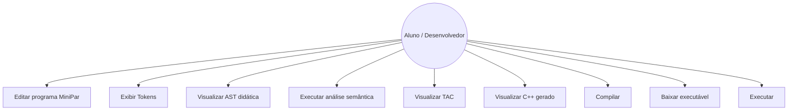

# UML — MiniPar 2026.2

## Diagrama de Componentes

## Diagrama de Classes dos Componentes Implementados

> Observação: a tabela de símbolos é implementada internamente no `SemanticAnalyzer` por uma pilha de escopos (mapas/dicionários), e não como uma classe separada.

## Casos de Uso

